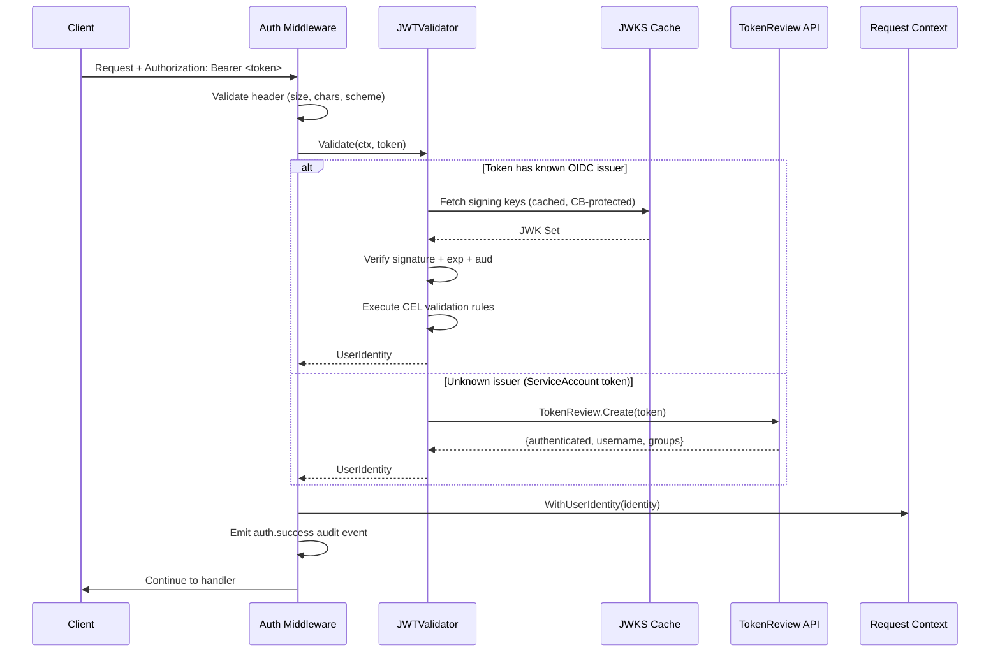
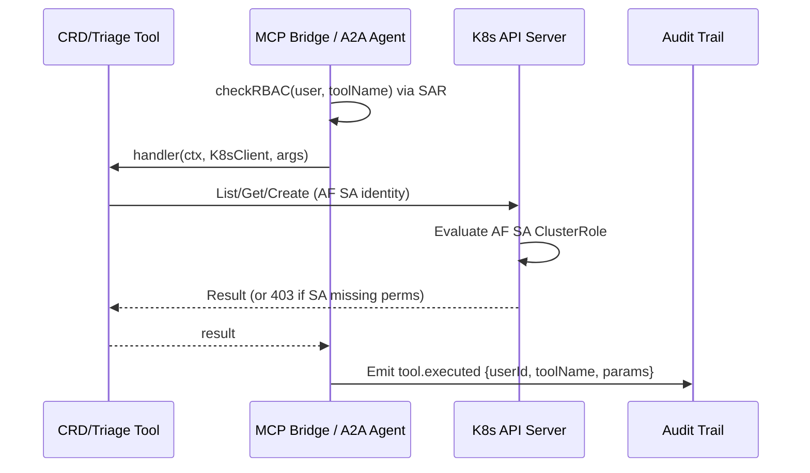

# Authentication and RBAC Model

**Service:** kubernaut-apifrontend
**NIST Controls:** AC-2, AC-3, AC-6, IA-2, IA-5, IA-8
**Source of truth:** `pkg/apifrontend/auth/sar.go` (per-tool SAR checks; role composition is operator-owned — see the demo example bundles in `test/fixtures/demo/rbac/`)
**Last updated:** 2026-11-28

---

## 1. Authentication Flow

Authenticated protocol requests to the API Frontend must carry a valid Bearer
token. The public health, readiness, metrics, agent-card, and Console contract
routes intentionally do not require authentication. The authentication
pipeline validates protocol tokens through a multi-stage process.



### Validation Stages

| Stage | Code Location | Failure Mode |
|-------|--------------|--------------|
| Body size enforcement | `handler/router.go:maxBodyMiddleware` | Route-specific behavior: A2A/root retain the a2a-go JSON-RPC baseline, `/a2a/status` returns HTTP 400 with JSON-RPC `invalid_request`, and other handlers retain their existing behavior; there is no service-wide 413 promise |
| Header sanitization | `security.ValidateHeaderValue` | 400 if control chars |
| Bearer scheme check | `middleware.go` L71-78 | 401 if non-Bearer |
| OIDC signature verification | `jwt.go` JWTValidator.Validate | 401 if signature invalid |
| Expiry validation | Claims.exp check | 401 `token_expired` |
| Audience validation | Claims.aud vs configured audiences | 401 `invalid_audience` |
| CEL rule evaluation | Compiled CEL programs per provider | 401 `cel_rule_failed` |
| TokenReview fallback | `tokenreview.go` K8s API call | 401 if not authenticated |

### JWKS Caching and Circuit Breaker

The `JWKSCache` fetches provider signing keys with:
- In-memory cache with TTL refresh
- Circuit breaker to prevent cascading failures if the OIDC provider is down
- Fail-open semantics: if cache has valid keys and circuit is open, validation continues with cached keys (see ADR-016)

### Backend-incarnation lifecycle boundary (#2614)

The public `GET /.well-known/kubernaut-console-contract.json` response contains
only the opaque `backend_incarnation` value and is `no-store`; it does not
receive a lifecycle header. After successful authentication, the exact process
value is returned in `X-Kubernaut-Backend-Incarnation` on `POST /a2a/invoke`,
`POST /`, `POST /mcp`, and `POST /a2a/status`, including authenticated handler
errors and post-authentication rate-limit responses. Missing or invalid
authentication and pre-authentication rate-limit responses do not receive the
header. The value contains no bearer token, cookie, raw Authorization value, or
user identity.

Console #168 owns browser qualification: missing, malformed, or changed values
fence stale work and trigger revalidation; a transient lifecycle-check failure
is retried without logging the user out; ambiguous non-idempotent operations are
never automatically replayed. Console #168 v1 qualification requires one AF
replica plus external OAuth2 Proxy evidence. HA/failover remains kubernaut#2606.

---

## 2. RBAC Model (SAR-based, v1.5+)

> **ADR**: [ADR-021](../adr/ADR-021-sar-based-tool-authorization.md)
> **Breaking change from v1.4**: The file-based `rbac_roles.yaml` has been removed.
> Authorization is now enforced via Kubernetes SubjectAccessReview (SAR).

After authentication, tool-level access control is enforced via Kubernetes
SubjectAccessReview (SAR) calls. The model is **fail-closed**: SAR errors or
denials result in tool rejection and an audit event.

### How It Works

1. The AF extracts `username` and `groups` from the authenticated JWT token.
2. On every `tools/call`, the AF performs a SAR check:
   ```yaml
   verb:     use
   group:    kubernaut.ai
   resource: tools
   name:     <toolName>
   ```
3. The Kubernetes RBAC engine evaluates the request against ClusterRoles and
   ClusterRoleBindings.
4. Results are cached for `sarCacheTTL` (default 30s) to reduce API server load.

### `tools/list` Is Unfiltered

Per [ADR-020](../adr/ADR-020-mcp-bridge-rbac-runtime.md), `tools/list` always
returns all registered tools regardless of caller identity. Authorization is
enforced only at `tools/call` execution time to eliminate TOCTOU races.

### Capability Roles (composition is the operator's)

The per-tool capability role is the product primitive: a ClusterRole
enumerating tool names under `kubernaut.ai/tools` (verb `use`,
resourceName = tool name), bound to OIDC groups via ClusterRoleBindings. The
operator renders only unbound generic console roles (kubernaut-operator#682);
which roles exist and which groups they bind to is the deployer's composition
decision (#2716: only roles and grants — no user classification).

The six demo bundles below (one role per demo IdP group) are a **worked
example composition**, not a platform contract; an entirely different set of
roles and group mappings is equally supported. They are also what the E2E
harness renders (`test/infrastructure`, `UT-INFRA-RBAC-002`).

### Operation → capability grant catalog

Every AF operation is one tool name. To let a user perform an operation, grant
`use` on `kubernaut.ai` `tools` with resourceName = the tool name (bound to one
of the user's OIDC groups via a ClusterRoleBinding). "Example bundles" lists
which of the six demo example compositions include the grant — pure
information; compose your own.

This table is drift-pinned against the registered tool set by
`UT-DOC-2716-001` (`test/infrastructure/tool_catalog_doc_test.go`).

<!-- tool-catalog:start -->
| Operation | Grant (resourceName) | Example bundles | Notes |
|---|---|---|---|
| List remediations | `kubernaut_list_remediations` | all six | |
| Get a remediation | `kubernaut_get_remediation` | all six | |
| Cancel a remediation | `kubernaut_cancel_remediation` | sre | |
| Watch remediation state | `kubernaut_watch` | all six | |
| Wait for KA session readiness | `kubernaut_await_session` | all six | |
| Initiate investigation (resource) | `kubernaut_investigate` | sre, ai-orchestrator | A2A + MCP bridge |
| Initiate investigation (alert) | `kubernaut_investigate_alert` | sre, ai-orchestrator | |
| Initiate remediation | `kubernaut_remediate` | sre, ai-orchestrator | |
| Check existing remediation | `kubernaut_check_existing_remediation` | sre, ai-orchestrator | |
| Approve / decline a RAR | `kubernaut_approve` | sre, remediation-approver | MCP/Console only — structurally removed from the A2A LLM toolset (DD-AF-006 consent guard) |
| List approval requests | `kubernaut_list_approval_requests` | sre, ai-orchestrator, remediation-approver | |
| Get an approval request | `kubernaut_get_approval_request` | sre, ai-orchestrator, remediation-approver | |
| List workflows | `kubernaut_list_workflows` | sre, observability, l3-audit | |
| Discover workflows (schemas) | `kubernaut_discover_workflows` | sre, ai-orchestrator | |
| Select a workflow | `kubernaut_select_workflow` | sre, ai-orchestrator | |
| Present a decision point | `kubernaut_present_decision` | sre, ai-orchestrator | MCP bridge name (canonical since #2713) |
| Complete investigation | `kubernaut_complete` | sre, ai-orchestrator | |
| Complete with no action | `kubernaut_complete_no_action` | sre | MCP/Console only (DD-AF-007) |
| Cancel investigation session | `kubernaut_cancel` | sre, ai-orchestrator | |
| Investigation session status | `kubernaut_status` | sre, ai-orchestrator | |
| Message an investigation | `kubernaut_message` | sre, ai-orchestrator | |
| Reconnect to a session | `kubernaut_reconnect` | sre, ai-orchestrator | |
| List firing alerts | `kubernaut_list_alerts` | sre, ai-orchestrator | A2A + MCP bridge (single canonical name since #2713) |
| Get alert details | `kubernaut_get_alert_details` | sre, ai-orchestrator | Chat/A2A only — not registered on the raw MCP bridge |
| Remediation history | `kubernaut_get_remediation_history` | sre, l3-audit | |
| Effectiveness metrics | `kubernaut_get_effectiveness` | sre, observability, l3-audit | |
| Audit trail | `kubernaut_get_audit_trail` | sre, l3-audit | |
| Read K8s objects | `kubectl_get` | sre, ai-orchestrator | |
| List K8s objects | `kubectl_list` | sre, ai-orchestrator | |
| List K8s events | `kubectl_list_events` | sre, ai-orchestrator | |
| List fleet clusters | `list_clusters` | sre, ai-orchestrator | |
<!-- tool-catalog:end -->

Console read capabilities (`kubernaut_read_policy_scope`,
`kubernaut_list_managed_resources`, `kubernaut_get_managed_resource`) are NOT
part of this per-tool contract: they are granted by the operator-rendered
`<ns>-console-reader` ClusterRole (see the
[interactive-mode setup guide](../../../../operations/deployment/INTERACTIVE_MODE_SETUP_GUIDE.md)).

### Roles the platform renders (and what they allow)

The operator renders exactly three unbound ClusterRoles, prefixed with the
Kubernaut CR's namespace. Everything else is operator-composed capability
roles (#2716).

| ClusterRole | Rule | What it allows |
|---|---|---|
| `<ns>-console-access` | `kubernaut.ai` `console`, verb `use` | Passing the console login gate (checked only when `consoleAccessAuthorizationCheckEnabled=true`; default is auth-only) |
| `<ns>-console-reader` | `kubernaut.ai` `tools`, verb `use`, resourceNames: `kubernaut_read_policy_scope`, `kubernaut_list_managed_resources`, `kubernaut_get_managed_resource` | The Console UI's read capabilities (policy scope, managed-resource projections) |
| `<ns>-console-inventory-reader` | core API-group `get`/`list` on local-target resources | The Console's inventory projection reads |

Bind them to your IdP groups via ClusterRoleBindings (see
[`test/fixtures/demo/rbac/console-bindings.yaml`](../../../../../test/fixtures/demo/rbac/console-bindings.yaml)
for a worked example). All checks are deny-by-default.

### Enforcement Code Paths

| Path | Code | Description |
|------|------|-------------|
| MCP Bridge | `handler/mcp_bridge.go:checkRBAC()` | Calls `ToolAuthorizer.Check()` |
| A2A Agent | `agent/root.go:newRBACGuard()` | BeforeToolCallback delegates to `ToolAuthorizer` |

### Fail-Closed Guarantees

| Condition | Result |
|-----------|--------|
| No UserIdentity in context | DENY |
| No Authorizer configured | DENY (panic at startup) |
| SAR API call fails | DENY + log error |
| SAR returns `allowed: false` | DENY + audit event |
| Empty user or tool name | DENY + error |

### Configuration

```yaml
rbac:
  sarCacheTTL: 30s   # TTL for SAR result cache (0 = no cache)
```

### Example ClusterRoleBinding

```yaml
apiVersion: rbac.authorization.k8s.io/v1
kind: ClusterRoleBinding
metadata:
  name: kubernaut-tool-sre-binding
roleRef:
  apiGroup: rbac.authorization.k8s.io
  kind: ClusterRole
  name: kubernaut-tool-sre
subjects:
  - kind: Group
    name: platform-sre        # OIDC group from JWT
    apiGroup: rbac.authorization.k8s.io
```

---

## 3. K8s Client Model: Unified AF ServiceAccount (ADR-022)

> **ADR**: [ADR-022](../adr/ADR-022-af-sa-unified-security-model.md)
> **Supersedes**: ADR-018 (impersonation risk acceptance), OIDC-direct mode (#1226)

All K8s API calls made by AF use the **AF pod ServiceAccount** regardless of
entry point (MCP or A2A). User identity is preserved in the application audit
trail via tool callbacks, not via K8s impersonation headers.

### K8s Client Flow



### Security Properties

- MCP RBAC (SAR-based) is the application-level access control gate
- Users never need K8s RBAC for kubernaut CRDs
- AF SA is the sole K8s identity for all tool operations
- User attribution is maintained via audit events (`tool.executed` with `UserID`)
- Impersonation headers are explicitly stripped by auth middleware (SEC-12)

---

## 4. Kubernetes RBAC (ClusterRole)

The operator-managed API Frontend ClusterRole grants the AF ServiceAccount. The
repository copy at `test/fixtures/kubernetes/apifrontend/base/02-rbac.yaml` is a
test-only parity fixture, not a production source of truth:

| API Group | Resources | Verbs | Purpose |
|-----------|-----------|-------|---------|
| `kubernaut.ai` | remediationrequests | get, list, watch, create, update, patch | CRD lifecycle (cancel, watch) |
| `kubernaut.ai` | remediationapprovalrequests | get, list, create, update, patch | Approval workflow |
| `kubernaut.ai` | remediationapprovalrequests/status | get, update, patch | Approval status updates |
| `kubernaut.ai` | signalprocessings, investigationsessions | get, list, watch, create, update, patch, delete | Session lifecycle |
| `kubernaut.ai` | */status | get, update, patch | Status subresource updates |
| (core) | events | get, list, create, patch | Triage reads + event creation |
| (core) | pods, replicationcontrollers, services, endpoints, configmaps, secrets, namespaces, nodes, persistentvolumeclaims | get, list | Triage tool reads (#1308) |
| `apps` | deployments, statefulsets, replicasets, daemonsets | get, list | Workload triage |
| `batch` | jobs, cronjobs | get, list | Job triage |
| `networking.k8s.io` | ingresses, networkpolicies | get, list | Network triage (#1308) |
| `autoscaling` | horizontalpodautoscalers | get, list | HPA triage (#1308) |
| `policy` | poddisruptionbudgets | get, list | PDB triage (#1308) |
| `authentication.k8s.io` | tokenreviews | create | JWT fallback validation |
| `authorization.k8s.io` | subjectaccessreviews | create | Authorization checks |

---

## 4.1 External Dependency Authentication: Prometheus

The severity triage pipeline (`internal/severity/triage.go`) queries Prometheus via HTTP for alert and rule data. This uses **service identity** authentication, not end-user impersonation:

| Property | Value |
|----------|-------|
| Client scope | AF ServiceAccount (not user impersonation) |
| Auth mechanism | Bearer token from SA projected volume (`prometheus.bearerTokenFile`) |
| TLS | Optional custom CA file (`prometheus.tlsCaFile`) for mTLS environments |
| Rationale | Prometheus metrics/rules are cluster-wide data; user-scoped access is not applicable |
| NIST | AC-6 (least privilege): AF only needs read access to `/api/v1/{alerts,rules,query}` |

This is distinct from the internal triage tools (`kubectl_get`, `kubectl_list`, `kubectl_list_events`) which use AF's ServiceAccount. Access to these tools is gated by MCP RBAC at the tool level — if a user has permission to invoke `kubernaut_investigate`, AF investigates on their behalf using its own SA.

---

## 5. Credential Lifecycle

| Credential | Type | Rotation | Storage |
|-----------|------|----------|---------|
| OIDC signing keys | JWKS (RS256/ES256) | Auto-refreshed from provider `.well-known/jwks.json` | In-memory cache |
| AF ServiceAccount token | K8s projected volume | Auto-rotated by kubelet (1h default) | tmpfs mount |
| User JWT | OIDC token | Short-lived (provider-configured, typically 5-60min) | Not stored; validated per-request |

---

## 6. Related ADRs

| ADR | Title | Relevance |
|-----|-------|-----------|
| ADR-013 | JWT Forwarding to KA | **Superseded by DD-AUTH-MCP-001 v3.0 (#1287)**: AF uses SA bearer token to KA/DS, not JWT delegation |
| ADR-016 | JWKS Fail-Open Rationale | When circuit breaker opens, cached keys allow validation to continue |
| ADR-018 | Impersonation Risk Acceptance | **Superseded by ADR-022** |
| ADR-022 | AF SA Unified Security Model | All K8s operations use AF SA; MCP RBAC is the application-level gate |

---

*Source files: `pkg/apifrontend/auth/middleware.go`, `pkg/apifrontend/auth/jwt.go`, `pkg/apifrontend/auth/tokenreview.go`, `pkg/apifrontend/auth/dynamic_impersonation.go`, and the operator RBAC contract; the repository fixture is `test/fixtures/kubernetes/apifrontend/base/02-rbac.yaml`.*
